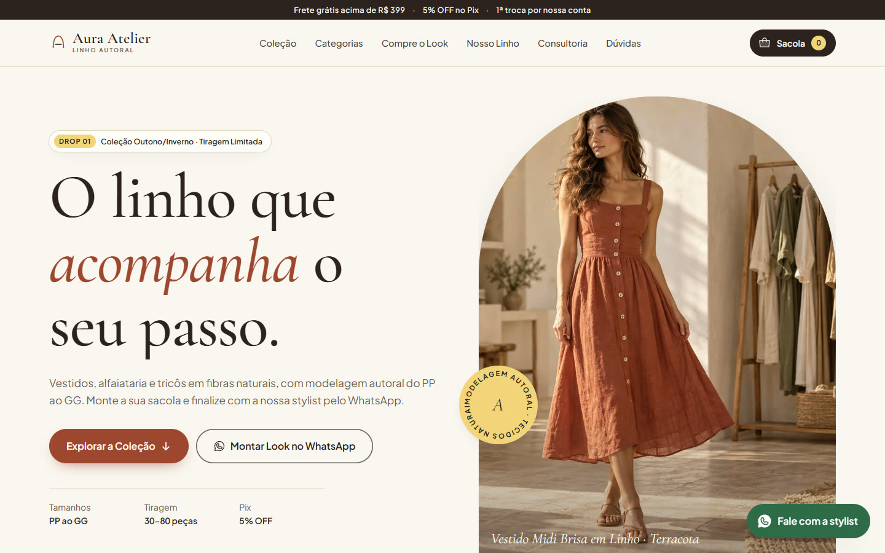
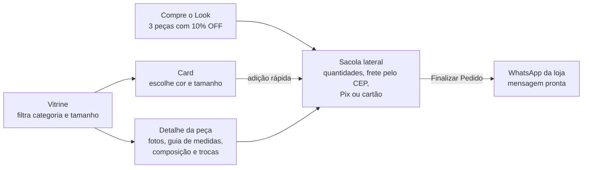
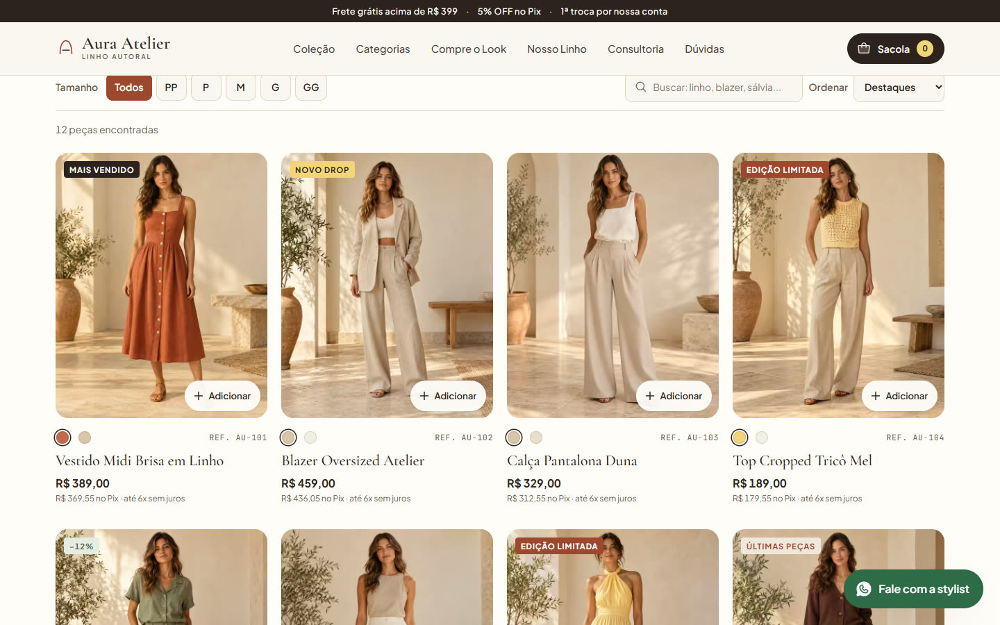
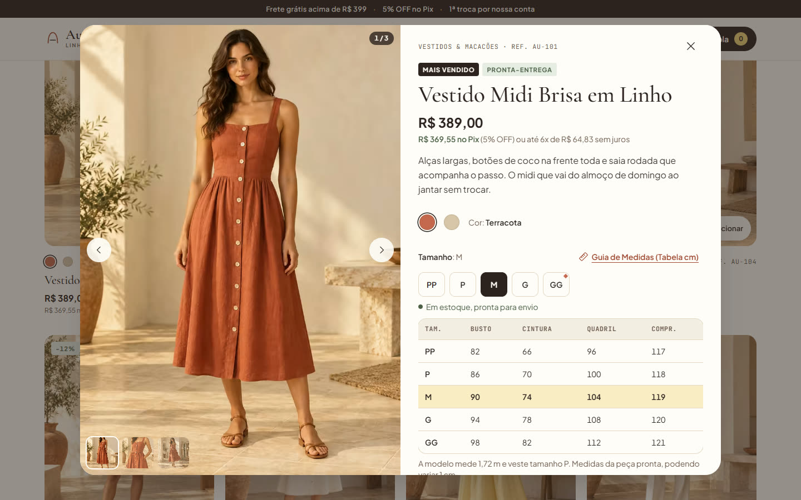
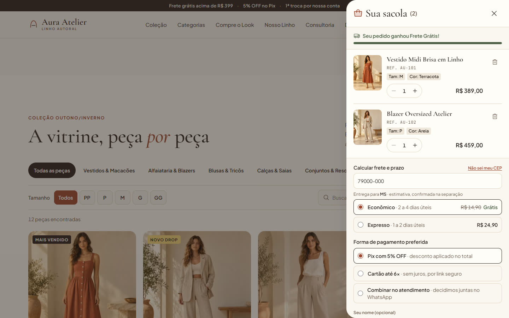
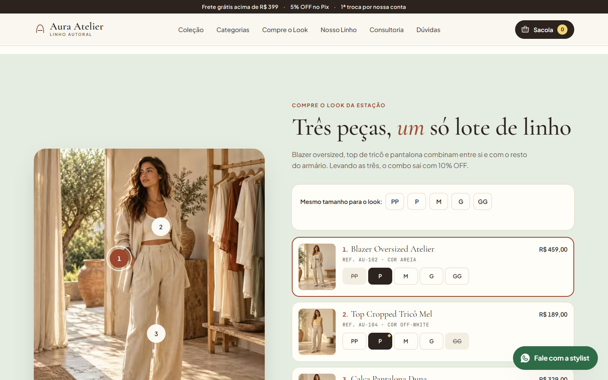
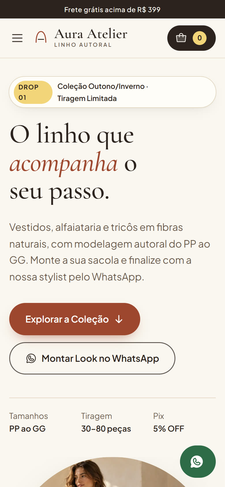
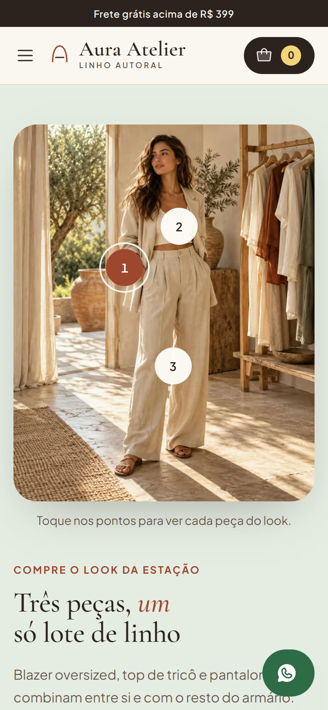
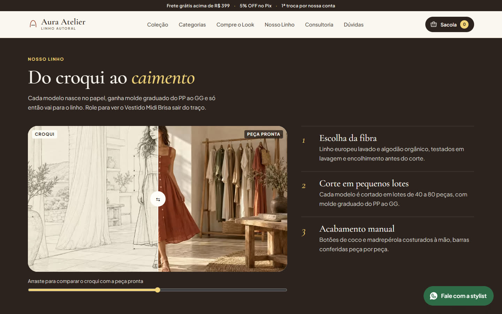

# Aura Atelier · Loja-boutique de moda feminina

[](https://github.com/LucasCamy/loja-roupa-landing/actions/workflows/deploy.yml)

Landing page de **loja-boutique de roupa feminina** com catálogo completo, sacola lateral e **pedido finalizado pelo WhatsApp**. É o modelo de *social commerce* que muitas lojas pequenas já usam no Instagram, com a experiência de um e-commerce: escolher cor e tamanho, consultar medidas em centímetros, montar a sacola, ver frete e desconto, e mandar tudo pronto para a vendedora numa única mensagem.

A marca **Aura Atelier · Moda Feminina & Linho Autoral** é demonstrativa: nomes, preços, estoques, depoimentos e modelos são fictícios, e as fotos foram geradas por IA. Tudo que identifica a loja fica em um único arquivo de configuração para virar a loja de verdade.

- **Site:** https://moda.cloudlane.com.br
- **Styleguide:** `/styleguide.html` (tokens, componentes e estados renderizados com o código do site)



---

## Por que existe

Lojas de moda que vendem pelo WhatsApp perdem vendas em dois pontos: a cliente não sabe que tamanho escolher, e o pedido chega picado em várias mensagens ("tem o vestido?", "qual cor?", "e no M?"). Esta página resolve os dois:

1. **Tamanho é informação de primeira classe.** Cada peça tem tabela de busto, cintura, quadril e comprimento, a altura e o tamanho da modelo, e os depoimentos dizem a altura de quem comprou e qual tamanho levou.
2. **O pedido chega estruturado.** A sacola gera uma mensagem com peça, referência, tamanho, cor, quantidade, subtotal, forma de pagamento, frete e prazo. A vendedora só confirma o estoque e envia o Pix ou o link do cartão.

Não há checkout, pagamento online nem backend: a conversa continua no WhatsApp, como a loja já trabalha.

## Como a compra funciona



Exemplo da mensagem que chega para a loja:

```text
Olá! Gostaria de finalizar meu pedido pelo site da Aura Atelier:

*ITENS DA SACOLA:*
• 1x Vestido Midi Brisa em Linho (Ref. AU-101)
  Tam: M | Cor: Terracota — R$ 389,00
• 1x Blazer Oversized Atelier (Ref. AU-102)
  Tam: P | Cor: Areia — R$ 459,00

──────────────────────
Subtotal: R$ 848,00
Pagamento preferido: Pix com 5% OFF (R$ 805,60)
Frete: GRÁTIS · Econômico para MS, 2 a 4 dias úteis (pedido acima de R$ 399,00)
Total estimado com frete: R$ 805,60
Cliente: Maria | CEP: 79000-000

Pode confirmar a disponibilidade para separação?
```

| Vitrine com filtros | Detalhe com guia de medidas |
|---|---|
|  |  |
| **Sacola com frete e pagamento** | **Compre o look da estação** |
|  |  |

## O que a página tem

| # | Seção | O que faz |
|---|---|---|
| 1 | **Topbar e navegação** | Benefícios (frete grátis, Pix, troca), menu e botão da sacola com contador e valor parcial |
| 2 | **Hero editorial** | Foto em moldura arqueada com vídeo ambiente, título revelado linha a linha e selo giratório |
| 3 | **Diferenciais** | Fibras naturais, numeração PP ao GG, atendimento no WhatsApp, 1ª troca grátis |
| 4 | **Categorias** | Mosaico que filtra a vitrine e rola até ela |
| 5 | **Vitrine** | 12 peças, filtro por categoria e tamanho em estoque, busca sem acento, ordenação; foto de detalhe no hover, cores no card e adição rápida por tamanho |
| 6 | **Compre o Look** | Foto com pontos clicáveis, tamanho por peça (ou um só para o look) e combo com 10% OFF |
| 7 | **Do croqui ao caimento** | 120 quadros em `<canvas>` controlados pela rolagem: o vestido sai do traço e vira peça pronta |
| 8 | **Consultoria e sob medida** | Briefing de ocasião, tamanho e tons com prévia da mensagem e validação acessível |
| 9 | **Sobre o ateliê** | Diretora criativa, manifesto e tabela de tiragem por peça |
| 10 | **Depoimentos** | Altura e tamanho comprado por cada cliente, com atalho para as medidas da peça |
| 11 | **Dúvidas** | Compra pelo WhatsApp, tamanhos e trocas, prazos, pagamento e cuidados com o linho |
| 12 | **CTA final, newsletter e rodapé** | Botão flutuante do WhatsApp, consentimento desmarcado, aviso de demonstração e dados do fornecedor |

Detalhes da sacola:

- Linha única por **peça + tamanho + cor**: o mesmo vestido em P e em M vira duas linhas; repetir a combinação soma a quantidade.
- Salva no navegador (`localStorage`), sem conta e sem cookie de rastreamento.
- Barra de progresso até o frete grátis (R$ 399).
- **Frete e prazo pelo CEP**, calculados no próprio navegador por faixa de CEP, sem enviar o CEP a nenhum serviço. O Econômico fica grátis acima do mínimo, e o Expresso é sempre pago.
- Pagamento preferido: Pix com 5% OFF, cartão em até 6x ou combinar no atendimento.

| Celular | |
|---|---|
|  |  |

## Direção visual

**Warm Mediterranean Boutique:** linho, terracota, sálvia e manteiga sobre fundo creme, com tipografia editorial.

- **Cores:** um acento de marca (terracota), sálvia e o verde do WhatsApp só como estado de sucesso, e contraste AA calculado para cada combinação de texto. A paleta completa está em [DESIGN.md](DESIGN.md).
- **Tipografia:** *Cormorant Garamond* para títulos e nomes de peças, com itálico em palavras-chave; *Plus Jakarta Sans* para interface e preços (números tabulares); *JetBrains Mono* para referências (`REF. AU-101`). Todas hospedadas no próprio site.
- **Movimento por etapas:** cada bloco anima quando você chega nele, não quando aparece o primeiro pixel. Títulos sobem por trás de uma máscara, fotos abrem como cortina, listas entram item a item. Com "reduzir movimento" ligado, tudo aparece pronto e a cena do croqui vira um comparador antes ↔ depois.



## Desempenho

A rolagem foi medida seção por seção com a CPU 4x mais lenta (`scripts/perf-scroll.mjs` e `scripts/perf-frames.mjs`), e as decisões vieram dessas medições:

- **Rolagem nativa.** A biblioteca de rolagem suave (Lenis) foi removida porque amarrava cada quadro ao JavaScript (~50% de quadros ruins). A cena do croqui continua suave pelo `scrub` do GSAP.
- **Animações no compositor.** Só `opacity` e `transform`. As fotos abrem com uma capa que recolhe, em vez de `clip-path` animado, que repintava a imagem a cada quadro.
- **Sem `backdrop-filter`** no cabeçalho fixo nem nos cards.
- **Imagens do tamanho certo.** AVIF com fallback WebP, versões de 640 px escolhidas via `srcset`/`sizes`, carregamento sob demanda, dimensões declaradas e `?v=<hash>` para invalidar o cache quando a mídia muda.
- **Canvas sem travar.** Os quadros do croqui são decodificados fora do thread principal (`img.decode()`), em lotes nos intervalos ociosos.
- **Estado em partes.** Abrir a sacola não re-renderiza a vitrine, e o painel desliza por animação nativa do navegador.

## Stack

| Camada | Tecnologia |
|---|---|
| Base | Vite 8, React 19, TypeScript (strict) |
| Estilo | Tailwind CSS v4 com tokens em CSS (`src/styles/tokens.css`, espelhados em `design/tokens.json`) |
| Movimento | Motion (`motion/react`) para interface e revelações; GSAP + ScrollTrigger só na cena do croqui |
| Ícones e fontes | Phosphor Icons, Fontsource (fontes no próprio site) |
| Testes | Vitest + Testing Library; Playwright para fluxo completo, screenshots e medição de desempenho |
| Entrega | Docker (Node → nginx-unprivileged), GitHub Actions, GHCR, k3s com Keel |

## Rodando localmente

Requer Node 24.

```bash
npm install
npm run dev          # http://localhost:5190  ·  styleguide em /styleguide.html
```

| Comando | Para quê |
|---|---|
| `npm test` | Testes unitários e de componente (sacola, frete, mensagem do WhatsApp, filtros, fluxos) |
| `npm run lint` · `npm run typecheck` | Verificação estática |
| `npm run build && npm run preview` | Build de produção em http://localhost:4190 |
| `npm run e2e` | Fluxo completo no navegador: filtros → detalhe → guia de medidas → 2 peças → sacola → CEP → link do WhatsApp |
| `npm run shots` | Screenshots e checagem de rolagem horizontal, imagens quebradas e erros de console em 8 larguras (360 a 1920) |
| `node scripts/perf-frames.mjs` | Quadros descartados por seção durante a rolagem (`HEADED=1`, `WIDTH=390`, `CPU=1`) |
| `docker compose up --build` | Imagem de produção em http://localhost:8080 |

Os scripts do Playwright usam o Edge ou o Chrome instalados (`BROWSER_CHANNEL=chrome` para trocar). `?movimento=1` na URL força as animações mesmo com "reduzir movimento" ligado.

## Transformando na sua loja

| O quê | Onde |
|---|---|
| Nome, WhatsApp, e-mail, Instagram, frete grátis, desconto Pix, parcelas, dados do fornecedor e `isDemo` | [`src/config/site.ts`](src/config/site.ts) |
| Peças: preço, cores, tamanhos em estoque, medidas, composição, cuidados, selos | [`src/data/products.ts`](src/data/products.ts) |
| Categorias e look da estação | [`src/data/categories.ts`](src/data/categories.ts), [`src/data/look.ts`](src/data/look.ts) |
| Tabela de frete por região e prazos | [`src/data/shipping.ts`](src/data/shipping.ts) |
| Depoimentos, FAQ, diferenciais, tiragem | [`src/data/content.ts`](src/data/content.ts) |
| Texto da mensagem do WhatsApp | [`src/lib/whatsapp.ts`](src/lib/whatsapp.ts) |
| Fotos (AVIF + WebP, 4:5 nos produtos) | `public/media/` e depois `bash scripts/make_small_variants.sh` |

Para cotação de frete real (Correios, Melhor Envio ou transportadora), troque `quoteShipping` em [`src/lib/shipping.ts`](src/lib/shipping.ts) por uma chamada ao seu backend; o token do serviço não pode ficar no navegador.

## Estrutura

```text
src/
  config/site.ts          marca, contatos e regras comerciais
  data/                   produtos, categorias, look, frete e textos (fictícios)
  lib/                    sacola (bag.ts, shop.tsx), frete, WhatsApp, catálogo, mídia
  components/ui/          Button, Sheet, SmartImage, SizeSelector, Reveal, Accordion...
  components/sections/    as 12 seções, ProductDetail e BagDrawer
  styleguide/             página /styleguide.html
  test/                   Vitest
public/media/             fotos AVIF/WebP, versões 640 px, vídeo e 120 quadros do canvas
scripts/                  e2e, screenshots, medição de desempenho e geração de mídia
docker/                   nginx.conf e cabeçalhos de segurança (CSP)
k8s/deploy.yaml           Deployment + Service do k3s
```

## Deploy

Cada push na `main` dispara o GitHub Actions: lint, typecheck e testes, depois build da imagem e publicação em `ghcr.io/lucascamy/loja-roupa-landing` (`:latest` e `:<sha>`). No cluster k3s do Cloudlane Homelab, o Keel detecta o novo digest em até 1 minuto e atualiza o pod sem indisponibilidade.

- **Imagem:** `nginx-unprivileged` na porta 8080, usuário não-root, raiz somente leitura com `/tmp` em memória, healthcheck em `/healthz`.
- **Cabeçalhos:** CSP restrita ao próprio domínio, `nosniff`, `Referrer-Policy`, `Permissions-Policy`.
- **Cache:** HTML com `no-cache`, `/assets/` imutável e `/media/` por 30 dias, versionada pelo hash.
- **Kubernetes:** [`k8s/deploy.yaml`](k8s/deploy.yaml) (namespace `landingpages`, Service LoadBalancer), exposto pelo Cloudflare Tunnel.

## Antes de usar com uma loja real

1. Preencha os contatos e os dados do fornecedor (razão social, CNPJ, endereço) em `site.ts` e mude `isDemo` para `false`. Enquanto faltarem, o rodapé mostra `[pendente]`.
2. Troque peças, preços, depoimentos e fotos fictícias por conteúdo real e autorizado.
3. Revise o [LEGAL_CHECKLIST.md](LEGAL_CHECKLIST.md) com um advogado (privacidade, trocas, direito de arrependimento, uso de imagem). As páginas legais atuais são minutas.

## Documentação

| Arquivo | Conteúdo |
|---|---|
| [DESIGN.md](DESIGN.md) | Sistema visual: paleta com contraste, tipografia, componentes, movimento e estados |
| [IMPLEMENTATION_PLAN.md](IMPLEMENTATION_PLAN.md) | Arquitetura, contratos de dados, desempenho e pendências |
| [AGENTS.md](AGENTS.md) | Convenções do projeto para quem (ou qual agente) for mantê-lo |
| [FIGMA_GUIDE.md](FIGMA_GUIDE.md) · [design/tokens.json](design/tokens.json) | Espelho do design system para o Figma |
| [MEDIA_README.md](MEDIA_README.md) · [MEDIA_MANIFEST.json](MEDIA_MANIFEST.json) | Origem, dimensões e textos alternativos de toda a mídia |
| [LEGAL_CHECKLIST.md](LEGAL_CHECKLIST.md) | Inventário de dados, licenças e o que falta revisar antes de publicar |
